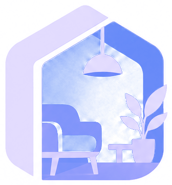
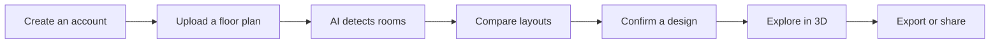

<div align="center">



# LiviSpace

### ✨ Design spaces for better living

Turn a floor plan into a beautiful, personalized interior design with
AI-assisted room analysis, smart layout recommendations, and an interactive
3D-style viewer.

<p>
  <a href="https://github.com/DuminduMalinga/Interior_Design_App"><strong>Explore the project</strong></a>
  ·
  <a href="#-getting-started"><strong>Run it locally</strong></a>
  ·
  <a href="#-feature-highlights"><strong>See the features</strong></a>
</p>

<p>
  
  
  
</p>

<p>
  
  
  
  
</p>

</div>

<br />

> **LiviSpace** brings the imagination of an interior designer to your floor
> plan. Upload your space, choose a room, discover layouts, and make the
> design yours.

## 🏠 What is LiviSpace?

LiviSpace is a cross-platform Flutter application for transforming floor plans
into AI-assisted interior designs. It combines a polished responsive
interface, Supabase-powered accounts and storage, room detection, layout
services, and a shareable 3D-style room experience.

## 🌟 Feature highlights

<table>
<tr>
<td width="50%" valign="top">

### 📐 Smart floor-plan analysis

- Upload JPG, JPEG, or PNG plans up to 10 MB, and check the chosen image in a preview before it is uploaded
- Detect rooms, walls, doors, and windows
- Estimate room dimensions and floor area
- See your uploaded plan with each detected room outlined on it, tap a room on the plan or in the list, and see where its size came from and how sure the detector is
- See rooms that can't be furnished yet listed apart, so it is clear what you can pick
- See suitability scores for detected rooms

</td>
<td width="50%" valign="top">

### 🛋️ Personalized layouts

- Explore room-specific recommendations
- Compare match scores and layout tags
- Furnish living rooms, bedrooms, kitchens, bathrooms, and dining areas
- Confirm a layout and save it as a design

</td>
</tr>
<tr>
<td width="50%" valign="top">

### 🎨 Explore and share

- Browse projects with search and refresh; each card says where the plan is in the flow (Uploaded, Rooms detected, Layouts ready, Layout chosen), what to do next, and the chosen layout's score
- See your totals on Home: floor plans uploaded, finished plans, and the last layout score
- Revisit saved designs from the app or web
- Orbit and zoom around an interactive room view, and reset it to the opening view
- See a layout's score, whether it is valid, the room's size and every piece in it; pick a piece to see its size, how it was placed and why, and find it outlined in the room (a panel over the room on a phone, beside it on a wider screen)
- Export designs as PNG or share them from your device

</td>
<td width="50%" valign="top">

### 👤 Personal experience

- Email or username authentication
- Forgot-password and reset-password flows
- Profile photo, usage statistics, and notification preferences
- Persistent light and dark themes

</td>
</tr>
<tr>
<td width="50%" valign="top">

### 🧭 Responsive by design

- Mobile bottom navigation
- Tablet and desktop side navigation
- Shared design tokens and reusable components
- Loading, empty, retry, and failure states throughout

</td>
<td width="50%" valign="top">

### 🔐 Administration

- Search and manage customer accounts
- Protected administrator accounts
- Administrative activity log
- Product news and test-send support

</td>
</tr>
</table>

## 🚀 The LiviSpace journey

<div align="center">

| 1 | 2 | 3 | 4 | 5 | 6 |
|:---:|:---:|:---:|:---:|:---:|:---:|
| **Create** | **Upload** | **Analyze** | **Choose** | **Customize** | **Share** |
| Join LiviSpace | Add a floor plan | Let AI read your space | Pick a room and layout | Save your design | Export or share |

</div>



## 🧩 Built with

| Layer | Technology |
| --- | --- |
| App | Flutter and Dart |
| Authentication and data | Supabase Auth, Database, Storage |
| AI analysis | Python wall detector with YOLO and EasyOCR |
| Layout generation | Room-specific layout services |
| File handling | `file_picker`, PNG export, and `share_plus` |
| Local preferences | `shared_preferences` |

## 🗂️ Project structure

<details>
<summary><strong>View the main modules</strong></summary>

| Area | Location | Responsibility |
| --- | --- | --- |
| App entry point | [`lib/main.dart`](lib/main.dart) | Flutter bootstrap, Supabase initialization, theme, and navigation |
| Design system | [`lib/app_theme.dart`](lib/app_theme.dart) | Colors, typography, spacing, radii, shadows, and themes |
| Shared components | [`lib/app_components.dart`](lib/app_components.dart) | Buttons, cards, inputs, logos, and reusable UI |
| Responsive layout | [`lib/responsive.dart`](lib/responsive.dart) | Mobile, tablet, and desktop breakpoints |
| Feature screens | [`lib/`](lib/) | Authentication, dashboard, projects, upload, layouts, profile, and admin |
| Plan overlay | [`lib/plan_overlay.dart`](lib/plan_overlay.dart) | The uploaded plan with tappable room outlines drawn over it |
| Data layer | [`lib/data/`](lib/data/) | Models, repositories, layout services, exports, and Supabase access |
| Backend schema | [`supabase/migrations/`](supabase/migrations/) | Database tables, functions, and policies |
| Edge functions | [`supabase/functions/`](supabase/functions/) | Notifications, account deletion, and username login |
| Wall detector | [`wall_detector/`](wall_detector/) | Room, wall, door, and window detection service |

</details>

### 🔗 Web app interoperability

LiviSpace shares floor-plan analysis and saved-design data with the companion
[Interior-Design-Web](https://github.com/DuminduMalinga/Interior-Design-Web)
application. A project can be started on one platform and continued on the
other through shared analysis and layout documents.

## ⚡ Getting started

### Prerequisites

- Flutter SDK with Dart SDK `^3.10.4`
- A configured Supabase project
- Android Studio, Xcode, or a desktop toolchain for your target platform

### Install and run

```bash
git clone https://github.com/DuminduMalinga/Interior_Design_App.git
cd Interior_Design_App
flutter pub get
flutter run
```

<details>
<summary><strong>Run on a specific device</strong></summary>

```bash
flutter devices
flutter run -d <device-id>
```

</details>

## ⚙️ Configuration

The app reads deployment-specific values through Flutter compile-time
environment variables. Never commit credentials or Supabase service-role keys.

### Supabase

Configure the Supabase URL and publishable/anonymous key in the environment
setup used by [`lib/env.dart`](lib/env.dart). Apply the migrations in
[`supabase/migrations/`](supabase/migrations/) to the target project.

### AI services

Point the app to the floor-plan detector and layout services at runtime:

```bash
flutter run \
  --dart-define=DETECTOR_URL=http://10.0.2.2:8000 \
  --dart-define=LAYOUT_SERVICE_BASE=https://<service-host>
```

Individual endpoints can also be supplied with
`LIVING_ROOM_LAYOUT_URL`, `BEDROOM_LAYOUT_URL`, `MASTER_BEDROOM_LAYOUT_URL`,
`KITCHEN_LAYOUT_URL`, `BATHROOM_LAYOUT_URL`, and `DINING_LAYOUT_URL`.

### Wall detector

The optional Python service in [`wall_detector/`](wall_detector/) uses YOLO
weights to detect rooms, walls, doors, and windows:

```bash
cd wall_detector
pip install -r requirements.txt
uvicorn server:app --port 8000
```

For local processing of uploaded plans, configure the required Supabase service
key only in the worker environment. Never expose it to the app or source
control.

## 🧪 Testing

```bash
flutter analyze
flutter test
```

The Flutter suite covers authentication, validation, models, services,
navigation, exports, themes, and responsive screens. The screen tests render
the app at mobile, tablet, and desktop widths.

Run the wall detector tests separately:

```bash
cd wall_detector
python -m unittest test_labels
```

## 🖥️ Supported platforms

| Mobile | Web | Desktop |
| --- | --- | --- |
| Android · iOS | Chrome and modern browsers | Windows · macOS · Linux |

## 📌 Project status

LiviSpace is an actively developed product prototype. The core experience,
authentication, data persistence, AI service integration, saved designs, and
responsive UI are implemented. Service URLs and Supabase deployment settings
must be configured for a production environment.

## 📄 License

No license has been declared for this repository yet.

<div align="center">

<br />

**Made with Flutter · Designed for better living**

<br />

<a href="#livispace">Back to top ↑</a>

</div>
